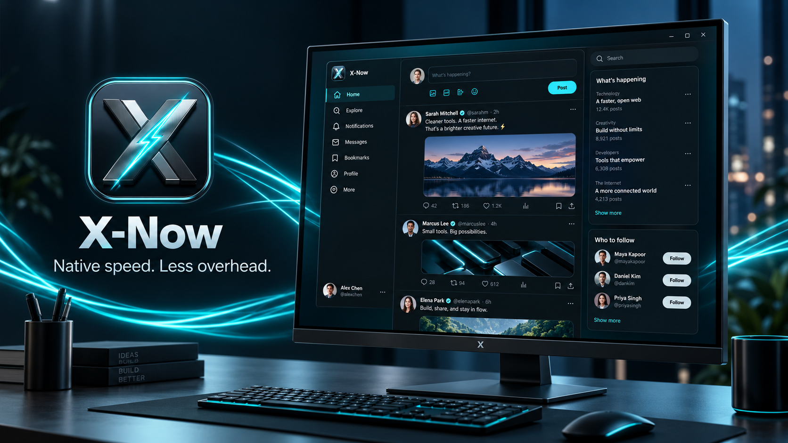
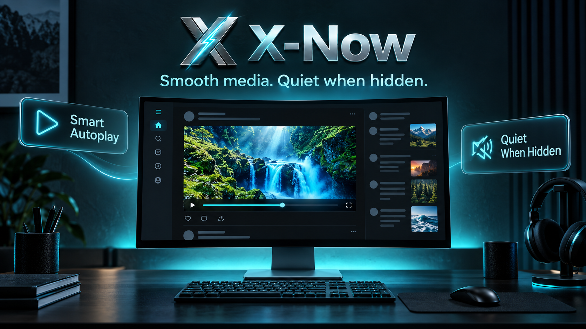
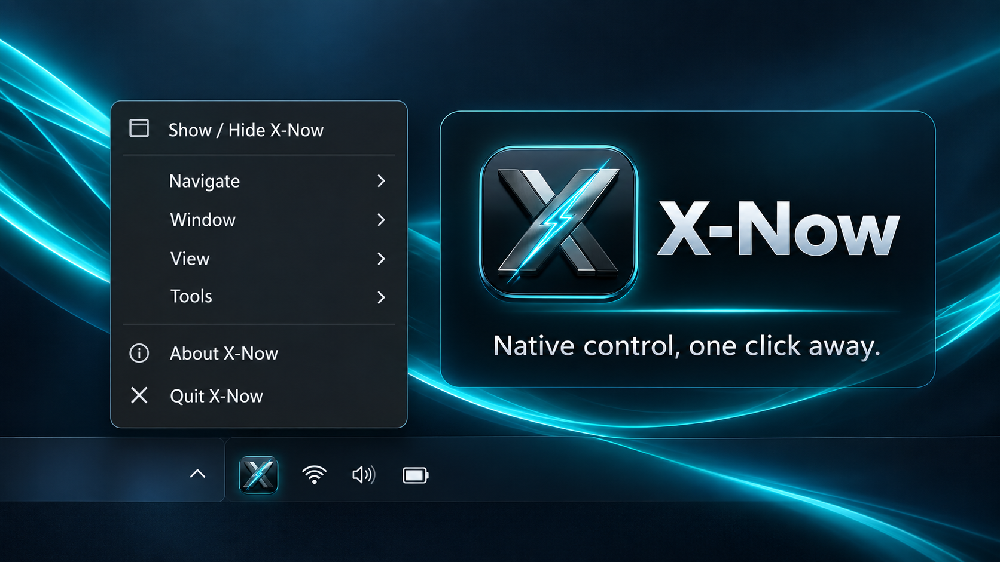

<p align="center">
  
</p>

<h1 align="center">X-Now</h1>

<p align="center">
  <strong>A native desktop client for <a href="https://x.com">X (formerly Twitter)</a></strong><br/>
  Built with <a href="https://tauri.app">Tauri v2</a> + Rust · WebView2 (Windows) · WebKit (macOS, Linux)
</p>

<p align="center">
  <strong>Latest: v2.6.0</strong><br/>
  <em>Native X-Now Downloader (left of Refresh feed) · image zoom slider & shortcuts · .jpg/.png/.mp4/.gif/.m4a & Full Post Bundle · Linux Wayland stability & performance tuning</em>
</p>

<p align="center">
  
  
  
  
  
  
  <a href="https://github.com/benedictusrey"></a>
</p>

---

X-Now puts X in its own window. It closes to the tray, pauses video and mutes sound while hidden, saves full-resolution media, and opens outside links in your default browser.

<p align="center">
  
  
  
</p>

> X-Now is not affiliated with, sponsored by, or maintained by X Corp. or Twitter, Inc. Use X and any downloader service according to their terms, local law, and the rights attached to the media.

---

## Download v2.6.0

Get the installer for your system from the **[v2.6.0 release page](https://github.com/benedictusrey/X-Now/releases/tag/v2.6.0)**. The file list and verification steps are in [docs/releases/X-Now_v2.6.0.md](docs/releases/X-Now_v2.6.0.md).

| System | File |
|---|---|
| **Windows 10/11, 64-bit** | `X-Now_2.6.0_windows_x64-setup.exe` (recommended) |
| Windows, no install | `X-Now_2.6.0_windows_x64-portable.exe` |
| Windows, MSI package | `X-Now_2.6.0_windows_x64_en-US.msi` |
| **macOS 11+** (Apple Silicon and Intel) | `X-Now_2.6.0_universal.dmg` |
| **Linux, most distributions** | `X-Now_2.6.0_amd64.AppImage` |
| Debian, Ubuntu | `X-Now_2.6.0_amd64.deb` |
| Fedora, RHEL, openSUSE | `X-Now_2.6.0_x86_64.rpm` |

Every release includes `SHA256SUMS.txt`. Check your download against it before you install. The packages are unsigned, so Windows SmartScreen and macOS Gatekeeper may show a warning.

---

## What changed: v2.6.0 vs v2.5.0

v2.5.0 is the previous release (older v2.5.0 vs v2.1.0 notes remain in [docs/releases/X-Now_v2.5.0-record.md](docs/releases/X-Now_v2.5.0-record.md)).

| Area | v2.5.0 | v2.6.0 |
|---|---|---|
| **Downloader** | Right-click save or external Cobalt fallback only | Native **X-Now Downloader** window (`Ctrl/Cmd+Shift+D`, context menu, tray **Tools**, and top-left rail button left of **Refresh feed**) |
| **Media formats** | Direct image save and progressive MP4 only | Compatible `JPG`/`PNG` (`?format=jpg|png&name=orig`), MP4/HLS (`aac_adtstoasc` + `+faststart`), looped `.gif` & `.m4a` extraction (via `ffmpeg`), editable `.txt`, and **Full Post Bundle** (`post.txt` + `metadata.json` + all media) |
| **Image Zoom Viewer** | Opens X's native lightbox | Built-in `10%–400%` zoom viewer (`Ctrl/Cmd+click` or *View / Zoom image*) with slider, drag-to-pan, mouse wheel, and keyboard shortcuts (`+`/`−`, `0`/`F` fit, `1` 1:1, arrows, `S`, `Esc`), plus `100%–400%` preview zoom in Downloader |
| **Linux Wayland & WebKitGTK** | Occasional black/frozen `<video>` playback, OAuth popup `SIGABRT` or blank white GTK popups, missing AppImage GStreamer plugins | Guarded DMA-BUF/GStreamer/compositing Wayland env, AppImage `bundleMediaFramework: true` + GStreamer deps, internal OAuth frame pass-through, and clean in-app sign-in routing without broken blank GTK popups |
| **Performance & memory** | Per-mutation observer array scans, `O(N·D)` audio tree walks, always-on timers, WebView2 suspend race | Single filtered DOM observer, suspended hidden timers/theme probes, `O(N)` audio BFS + closed Windows snapshot handles, sequenced `pause -> TrySuspend()`, and cross-filesystem safe temp writes |
| **Accessibility & UI** | `#71767b` muted text on dark overlays, static backdrop blur | WCAG AA `#8b98a5` contrast across Downloader & overlays, native macOS/Linux font stacks, range/rail `:focus-visible`, keyboard theme radiogroup, and touch/pointer-capture cleanup |
| **Automated checks** | 41 Rust tests, 94 + 80 JS/UI assertions | **50 Rust tests** (45 on Linux), **106 helpers**, **82 UI**, and **30 Downloader** JS assertions |

**Known limits in v2.6.0:** packages are unsigned; `.m4a` audio extraction, `.m3u8` HLS remuxing, and `.mp4` → `.gif` conversion require `ffmpeg` on `PATH`; there is no Windows ARM64 build.

---

## Features

- **Close to tray:** the ✕ button hides X-Now to the tray. Click the tray icon to bring it back.
- **Pause and mute when hidden:** video and audio pause, and sound mutes, when the window is minimized or hidden. Both are optional in Settings.
- **Native X-Now Downloader:** inspect any X/Twitter post URL or ID (`Ctrl/Cmd+Shift+D`, the rail button left of **Refresh feed**, right-click menu, or tray **Tools**) to save compatible `.jpg`/`.png` photos, HD `.mp4` videos, `.gif` animations, `.m4a` audio, or Full Post Bundles.
- **Image zoom slider & shortcuts:** `Ctrl/Cmd+click` (or right-click → *View / Zoom image*) opens a `10%–400%` zoom viewer with drag-to-pan and keyboard shortcuts (`+`/`−`, `0`/`F`, `1`, arrows, `S`, `Esc`).
- **Tray menu:** Navigate, Settings, View, Tools, and How to submenus, zoom, always on top, launch on startup, and site cache clearing.
- **External links & sign-in:** external links open in your default browser; Apple/Google embedded sign-in frames load safely while already-signed-in sessions suppress redundant OAuth popups.
- **Settings:** see the table below.

---

## Settings

Open Settings with the X-Now button beside X's logo, or from the tray.

| Setting | Default | What it does |
|---|---|---|
| Hide to tray on close | On | ✕ hides the window to the tray |
| Keep on top | Off | Keeps the window above other windows |
| Start when you sign in | Off | Read-only in Settings. Change it from the tray menu |
| Pause video | On | Pauses video and audio while the window is hidden |
| Mute sound | On | Mutes sound while the window is hidden. On Windows, also mutes the app's audio session |
| Sleep the page | On | Lowers the page's memory use while hidden (Windows) |
| Schedule (Quiet hours) | Off | Off, Nights (23:00 to 07:00), or a custom window. Pauses and mutes video and blocks autoplay |
| Feed video volume | 20% | Volume for timeline videos |
| Opened video volume | 50% | Volume for opened videos |
| Unmute videos when X-Now is active | On | Unmutes feed and opened videos while X-Now is the focused window |
| Open Cobalt when a video can't be saved | On | Opens Cobalt when X exposes only a streamed video |
| Zoom | 100% | Page zoom from 50% to 300%. Kept after restart |
| Theme | Follows X | Switches X's Background between Default and Lights out |
| Motion | System | System, Reduce or Full |
| Focus layout | Off | Hides trends and promo cards in X's right column |
| Saved media | Last 50 | Lists recent saves, each with *Show in folder* |

---

## Quick Start

### Windows

1. Install the [Microsoft Edge WebView2 Runtime](https://developer.microsoft.com/en-us/microsoft-edge/webview2/) if it is missing.
2. Run the setup file, or run the portable file without installing.
3. Sign in on X's page inside the app. Your session stays on this computer, and you can reopen X-Now later without signing in again.

### macOS

1. Open the DMG and drag **X-Now** to Applications.
2. On first launch, right-click **X-Now** and choose **Open**. The build is unsigned.
3. Sign in on X's page inside the app.

### Linux

1. For the AppImage, run `chmod +x X-Now_2.6.0_amd64.AppImage`, then run it. For the `.deb` or `.rpm`, use your package installer.
2. You need the WebKitGTK 4.1 runtime. On Debian and Ubuntu, install `libwebkit2gtk-4.1-0`.
3. Sign in on X's page inside the app.

---

## Media and Audio

| Context | Sound | Notes |
|---|---|---|
| Feed videos | 20% volume. Unmuted while X-Now is focused, if *Unmute videos when X-Now is active* is on | Autoplays when visible; pauses when scrolled out of view. One video plays at a time |
| Opened videos | 50% volume | X's own mute and fullscreen controls stay in charge |
| Hidden or closed to tray | Video pauses and sound mutes, if the two switches are on | On Windows, the app's audio session is muted too |
| Restore | Resumes the video that was playing if it is still on screen. Otherwise the first video in view | Nothing plays off screen |

X-Now does not add its own player controls. Play, mute, fullscreen, captions and quality stay X's.

---

## Saving Media

- **X-Now Downloader:** click the **Downloader** icon on the top-left rail (directly left of **Refresh feed**), press `Ctrl/Cmd+Shift+D`, choose *Open in X-Now Downloader* from the media context menu, or pick *X-Now Downloader…* in the tray **Tools** menu. Save compatible `JPG` or `PNG` photos, HD `.mp4` / HLS streams, looped `.gif` animations, `.m4a` audio tracks, edited post text (`.txt`), or a **Full Post Bundle** (`post.txt` + `metadata.json` + all media) to `Downloads\X-Now`.
- **Quick save & zoom:** right-click an image or video for instant save, or `Ctrl/Cmd+click` (*View / Zoom image*) to open the `10%–400%` zoom viewer (`+`/`−`, `0`/`F`, `1`, arrows, `S`, `Esc`).
- **Progress & fallback:** a toast shows save progress, and if X exposes only a streamed link without direct access, the optional Cobalt hand-off remains available in your default browser.
- **History:** Settings lists the last 50 saves, each with *Show in folder*.

X-Now downloads only the media URLs that X's pages expose. It does not bypass X's access controls. Media rights belong to the author of the post.

---

## Privacy and Security

- No analytics, no telemetry and no account database. X-Now does not see your password.
- Your signed-in session stays in WebView2's profile on this computer.
- Settings and the saved-media list are stored in `%APPDATA%\com.xnow.desktop\settings.json`. Nothing is uploaded.
- X's page can call only a few native commands: open a link in the browser, save media bytes, prepare the download folder, download a media URL X already exposed, read and change Settings, and open the folder of a saved file. See [SECURITY.md](SECURITY.md).
- Keep these private: your WebView session data, the files in `Downloads\X-Now`, and any post URL you copy.

---

## Build and Test

Install [Node.js](https://nodejs.org/), [Rust](https://rustup.rs/), and run these from the repository root:

```sh
npm install                 # once: jsdom and playwright-core for the test harnesses
npm run test:all            # Rust tests (50), helpers (106), UI (82), Downloader (30)

cd src-tauri && cargo fmt --all -- --check && cargo check && cd ..
npx --yes @tauri-apps/cli@2.11.5 build --bundles nsis,msi   # add --no-bundle for the exe only
```

To keep build output outside the source tree on Windows, set `CARGO_TARGET_DIR` first:

```powershell
$env:CARGO_TARGET_DIR = 'C:\path\to\x-now-build-target'
npx --yes @tauri-apps/cli@2.11.5 build --bundles nsis,msi
```

The live Settings suite drives the built exe. It runs on Windows only with `npm run test:live`. It closes any running X-Now and restores `settings.json` at the end.

---

## Diagnostics

Each launch logs the WebView2 configuration:

```text
[X-Now] Launch config: webview_args="--disable-features=msWebOOUI,msPdfOOUI,msSmartScreenProtection,CalculateNativeWinOcclusion --disable-direct-composition-video-overlays --autoplay-policy=no-user-gesture-required" dark_background=true diagnostics=false
[X-Now] Native background synced to page theme: #ffffff
```

| Flag | Effect |
|---|---|
| *(none)* | Recommended. Background sync, occlusion fix, video-overlay fix and the autoplay switch |
| `--no-occlusion-fix` | Turns off only the occlusion fix |
| `--no-gpu-video-overlays-fix` | Turns off only the video-overlay fix. Use it if a black band appears |
| `--webview-default` | Stock WebView2 behavior, with no workarounds |
| `--webview-args "..."` | A full custom argument list. The WebView UI defaults are always kept |
| `--webview-diagnostics` | Logs WebView state at startup and on every hide and show |

`XNOW_WEBVIEW_ARGS` sets the same override for installed copies. The log goes to stderr, so run X-Now from a terminal to capture it, for example with `2> xnow.log`. A custom list replaces the defaults, so include the autoplay switch if you keep the unmute setting.

---

## Documentation

| Document | What you'll find |
|---|---|
| [docs/releases/X-Now_v2.6.0.md](docs/releases/X-Now_v2.6.0.md) | v2.6.0 downloads, what's new, requirements, and known limits |
| [docs/releases/X-Now_v2.5.0.md](docs/releases/X-Now_v2.5.0.md) | v2.5.0 downloads and release summary |
| [docs/releases/X-Now_v2.5.0-record.md](docs/releases/X-Now_v2.5.0-record.md) | Full v2.5.0 record: sign-in, audio, Settings, release workflow, verification |
| [RELEASE_NOTES.md](RELEASE_NOTES.md) | Short release notes for each version |
| [CHANGELOG.md](CHANGELOG.md) | Version history, one entry per release |
| [SECURITY.md](SECURITY.md) | Supported versions, capabilities, security and privacy guarantees |
| [CONTRIBUTING.md](CONTRIBUTING.md) | Project layout, invariants, and the pull request steps |
| [docs/RELEASE_PIPELINE.md](docs/RELEASE_PIPELINE.md) | Release workflow, asset names and release steps |
| [docs/BUILD_AND_FIXES.md](docs/BUILD_AND_FIXES.md) | Rendering, window and audio fixes, with bisect flags. Read it before changing `lib.rs`, `tray.rs` or `frontend/x-tools.js` |
| [docs/GITHUB_DESKTOP_PUBLISHING.md](docs/GITHUB_DESKTOP_PUBLISHING.md) | Historical v2.1.0 publishing guide, kept for reference |
| [AGENTS.md](AGENTS.md) | Provenance, attribution rules and locked architectural pillars for AI agents |
| [AUTHORS.md](AUTHORS.md) | Authorship declaration and attribution policy |

---

## Author

X-Now is conceived, engineered, and maintained solely by  
**Benedictus Reynaldo Hartanto** ([@benedictusrey](https://github.com/benedictusrey))  
Repository: [https://github.com/benedictusrey/X-Now](https://github.com/benedictusrey/X-Now)

The project is independent of X Corp. and Twitter, Inc. Contributions and reproducible bug reports are welcome, as long as they do not include credentials, private session data or private downloaded media.
